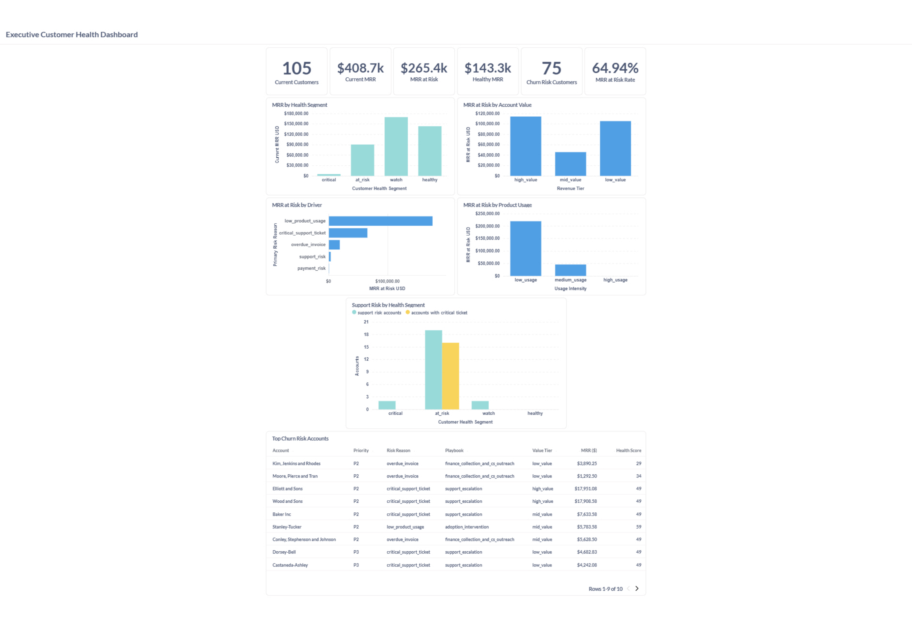
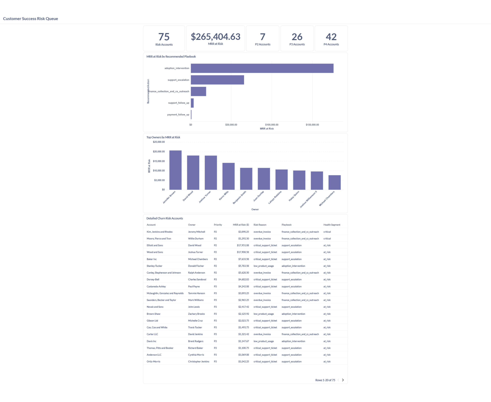

# SaaS Revenue & Customer Health Platform

An analytics engineering platform connecting synthetic CRM, billing, product activity and support data to account-level metrics and Customer Success prioritization.

## Business questions

- Which current customers need intervention, and why?
- How much current MRR is associated with risk signals?
- How do product adoption, unresolved support issues and payment behavior affect account health?
- Which actions should Customer Success prioritize?

## Architecture

`Synthetic source snapshots → stable PostgreSQL raw tables → dbt staging → intermediate aggregates → six marts → Metabase`

The warehouse has 21 models. Source entities are aggregated at their intended grain before joins, preventing one-to-many sources from multiplying account revenue. dbt tests cover identifiers, relationships, permitted values and business reconciliations.

Raw loading replaces rows inside a single transaction without dropping tables. All nine source snapshots and their load audit entries commit together. A failed source rolls back the transaction; dependent views remain in place.

## Stack

Python, PostgreSQL 16, dbt, Metabase, Docker Compose, SQLAlchemy, GitHub Actions, Ruff and SQLFluff. An optional Airflow DAG defines orchestration; the Airflow runtime is not included in Compose.

## Metric contracts

- **Current MRR:** active and past-due subscription monthly recurring revenue.
- **MRR at risk:** current MRR on accounts matching the documented risk policy.
- **Usage intensity:** activity in the inclusive 90-day window ending at the observation date.
- **Critical/high-priority support risk:** unresolved tickets created on or before that date.
- **Health score:** a bounded, rule-based prioritization score, not a calibrated churn probability.
- **Revenue-retention mart:** current revenue exposure by health/value segment; historical NRR/GRR are not calculated.

The bundled data uses a reproducible observation date of `2025-12-31`. Override `as_of_date` and `usage_window_days` with dbt `--vars` for another observed dataset. A live implementation must supply source histories appropriate to that date.

## Main marts

| Model | Grain and purpose |
|---|---|
| `mart_account_360` | One row per account, lifecycle, revenue and risk signals |
| `mart_customer_health` | Account health classification and recommended action |
| `mart_churn_risk` | Risk queue with reason, playbook and priority |
| `mart_revenue_retention` | Current revenue exposure by segment and action |
| `mart_product_adoption` | Adoption patterns by health/value segment |
| `mart_support_operations` | Support burden and unresolved support risk |

See `docs/data_model.md`, `docs/metrics_dictionary.md` and dbt column documentation for details.

## Run

Python 3.12 and Docker Compose:

```bash
python -m venv .venv
# Activate .venv for your shell.
pip install -r requirements.txt
# Copy .env.example to .env and configure the local connection.
docker compose up -d
python scripts/generate_synthetic_data.py
python scripts/load_raw_to_postgres.py
python scripts/validate_raw_data.py
dbt deps --project-dir warehouse/dbt --profiles-dir warehouse/dbt
dbt build --project-dir warehouse/dbt --profiles-dir warehouse/dbt
python scripts/collect_table_row_counts.py
python scripts/check_raw_reload.py
```

The PowerShell runner `scripts/run_pipeline.ps1` also records pipeline/stage audit entries. See `OPERATIONS_RUNBOOK.md`. `POSTGRES_HOST` must identify the actual execution environment: normally `localhost` on the host, or the service hostname inside a container. Set the same database credentials/port for Python and dbt.

## Verification

```bash
pip install -r requirements-dev.txt
python -m pytest -q
ruff check scripts orchestration/airflow/dags
ruff format scripts orchestration/airflow/dags --check
sqlfluff lint warehouse/dbt/models warehouse/dbt/tests
```

The Python regression tests exercise reloads with dependent views and rollback when a later source fails. CI builds the warehouse and runs `check_raw_reload.py` afterward. dbt business tests include open-critical-ticket semantics and MRR reconciliation.

## Dashboard layout examples

These images illustrate executive and operational layouts from an earlier sample run. Rebuild and refresh the dashboards for values under the current observation window and risk policy.




Metabase definitions are not exported as deployable dashboard assets. Recreating the visual layer in a clean instance remains a manual setup step; dbt exposures document its dependencies.

## Operational scope

Audit tables record raw loads, validation results and warehouse row counts. The PowerShell runner records pipeline and stage status. The Airflow DAG provides a schedule/retry definition but requires a separately configured Airflow runtime. Source freshness alerting, incremental history, service-level targets and deployment/load verification are future operational work, not guarantees of the demo.
